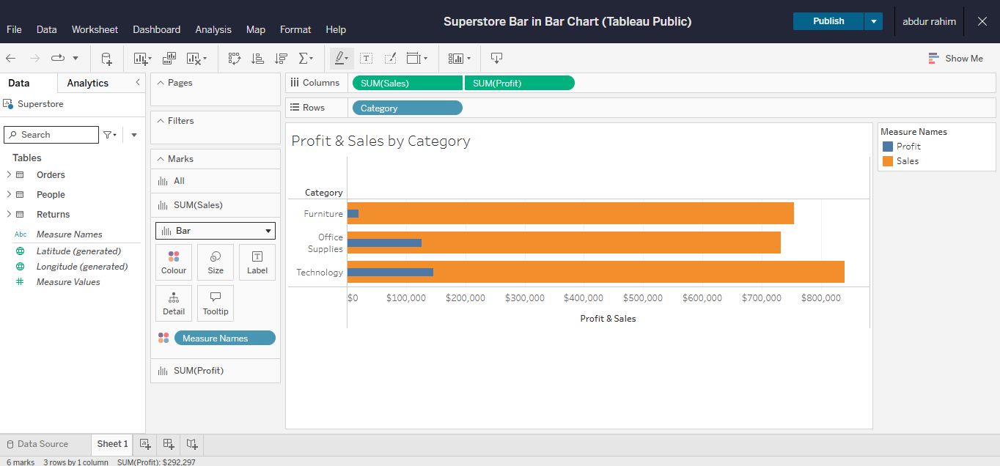

# Superstore Bar-in-Bar Chart | Tableau Sales & Profit Analysis

## Project Overview

This project demonstrates how Tableau can be used to compare Sales and Profit performance across different product categories using a Bar-in-Bar Chart.

Using the Sample Superstore dataset, the visualization combines two business measures in one view, making it easier to compare their values across Furniture, Office Supplies, and Technology.

## Visualization Preview



## Key Features

- **Sales Comparison:** Displays Sales performance using orange bars.
- **Profit Comparison:** Displays Profit performance using blue bars.
- **Category Analysis:** Compares Furniture, Office Supplies, and Technology.
- **Combined Visualization:** Presents Sales and Profit together for category-level comparison.

## Tableau Techniques

- Bar-in-Bar Chart
- Multiple Measures
- Measure Names
- Category-Based Analysis
- Data Visualization and Formatting

## Dataset

**Sample Superstore**

The visualization uses the following fields:

| Field | Description |
|---|---|
| Category | Product category |
| Sales | Total sales value |
| Profit | Total profit value |

## Tools & Skills

- Tableau Public
- Data Visualization
- Data Analysis
- Business Intelligence
- Comparative Analysis

## Repository Structure

```text
superstore-bar-in-bar-chart/
├── Dashboard/
│   ├── Superstore_Bar_in_Bar_Chart.twbx
│   └── README.md
├── Images/
│   ├── bar-in-bar-chart-overview.png
│   └── README.md
└── README.md
```

**Tableau Public:** [View Interactive Bar-in-Bar Chart](https://public.tableau.com/app/profile/abdur.rahim5381/viz/SuperstoreBarinBarChart/Sheet1)

## Project Type

Independent learning and portfolio project.
